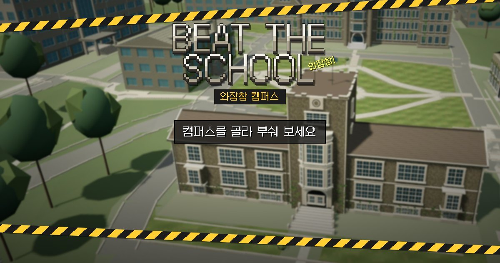

# Beat the School

실제 학교 캠퍼스를 3D 로 만들어 부수는 웹 게임이에요. 학교 부수기 게임의 원조로, 2026년 10월 14일 22시 3분(KST)에 처음 공개했어요(Vercel 첫 배포 기록).

플레이: https://beattheschool.com

## 조작

| | 컴퓨터 | 휴대폰 · 태블릿 |
| --- | --- | --- |
| 타격 | 클릭 | 터치 |
| 이동 | 드래그 | 드래그 |
| 확대 | 휠 | 두 손가락 |
| 회전 | 오른쪽 드래그 | 두 손가락 |
| 누르는 무기일 때 이동 | Space + 드래그 | 두 손가락 |

컴퓨터에서는 1 ~ 0 으로 무기를 고르고, B 로 무기 가방을 열고, R 로 다시 시작해요.

WebGL 2 를 지원하는 브라우저에서 돌아가요.

## 내 학교 버전 만들기

학교 하나는 `src/campuses/registry.js` 의 한 줄, `src/campuses/<id>/`(건물 배치 · 지형 · 불러오는 코드), `assets/campuses/<id>/`(3D 모델 · `manifest.json`), 학교 페이지 `<id>/index.html` 로 이뤄져요. 건물이 하나뿐인 `liraart` 를 본떠 바꿔 보면 가장 쉬워요. 3D 모델을 자동으로 만드는 도구는 이 저장소에 없어요.

내려받은 폴더에서 `python3 -m http.server 4942` 처럼 정적 서버를 띄워 열어 봐요.

## 만든 사람 · 저작권

© 2026 HealthCoding. 어느 학교와도 관계없는 개인 프로젝트예요.

## 이용 조건

- 출처를 밝히면 비상업적으로 자유롭게 가져다 쓰고, 고치고, 다시 올릴 수 있어요. 자기 학교 버전을 만들어도 돼요.
- 코드는 [PolyForm Noncommercial 1.0.0](https://polyformproject.org/licenses/noncommercial/1.0.0), HealthCoding 이 만든 3D · 그림 · 소리 · 음악은 [CC BY-NC 4.0](https://creativecommons.org/licenses/by-nc/4.0/) 이에요.
- 출처는 'Beat the School © 2026 HealthCoding' 과 원본 주소(https://beattheschool.com 또는 https://github.com/HealthCoding/beat-the-school)로 적어요. 공식판처럼 보이게 하면 안 돼요.
- 플레이 화면 · 영상 · 방송은 수익이 나도 자유예요. 그 밖의 상업적 이용(판매 · 광고 · 유료 서비스 등)은 허락이 필요해요.
- 첫 화면 노래 '캠퍼스를 부수고 싶어'는 이용 허락에서 빠지고, 이 저장소에도 없어요. 이 저장소로 돌리면 첫 화면 노래만 나오지 않아요. 플레이 영상 · 방송에 함께 담기는 건 괜찮지만, 노래만 따로 쓰면 안 돼요.
- 학교 지도 데이터(건물 윤곽 · 자리 · 길)는 OpenStreetMap 자료로, ODbL 1.0 을 따라요(© OpenStreetMap contributors). 제3자 부품 · 효과음 · 지형 자료는 각자의 라이선스를 따라요.
- 자세한 내용은 [LICENSE](LICENSE) · [credits.html](credits.html) 에 있어요.

## English

Beat the School is a web game where you smash 3D models of real school campuses. It is the original school-smashing game, first released on 14 October 2026 at 22:03 KST (first Vercel deployment record). © 2026 HealthCoding — a personal project unrelated to any school. You are welcome to play it, share links to it and post videos or streams of your play, including monetised ones. You may use, change and republish it for non-commercial purposes, including making a version for your own school, as long as you credit "Beat the School © 2026 HealthCoding" with the original address and do not present it as official. The code is under the PolyForm Noncommercial License 1.0.0 and HealthCoding's own 3D models, images, sounds and music are under CC BY-NC 4.0; other commercial use needs permission. The title-screen song is not licensed and is not in this repository, so a copy run from here plays no title song; it may be heard in videos of your play but not used on its own. The school map data is © OpenStreetMap contributors under ODbL 1.0, and third-party components, sound effects and terrain data follow their own licenses. A school is one line in `src/campuses/registry.js` plus `src/campuses/<id>/`, `assets/campuses/<id>/` and the page `<id>/index.html`; the one-building `liraart` is the easiest one to copy. See [LICENSE](LICENSE) and [credits.html](credits.html).

문의 / Contact: healthcoding15@gmail.com
